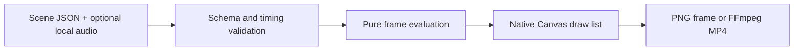

<p align="center">
  
</p>

<p align="center">
  <strong>From script and voice to animated stories.</strong><br>
  A declarative 2D scene runtime and narrated-video workflow in development.
</p>

<p align="center">
  <a href="QUICKSTART.md">Quickstart</a> ·
  <a href="docs/SCENE_FORMAT.md">Scene format</a> ·
  <a href="docs/ENGINE_PRODUCT_PLAN.md">Architecture plan</a> ·
  <a href="ROADMAP.md">Roadmap</a> ·
  <a href="CONTRIBUTING.md">Contributing</a>
</p>

## See the alpha in motion


The GIF is a silent excerpt from a real engine render. **[Watch the complete demo with narration](showcase/rachana-demo.mp4)**, inspect its [scene JSON](examples/narrated-story/scene.json), or follow the [quickstart](QUICKSTART.md) to render it locally. The approximately 25-second demo combines text, moving shapes, and reveal cues anchored to synthetic narration. It is an editable example of the current runtime, not an automatically directed production.

## Project status

**Working alpha: declarative scenes, a local CLI, and supplied narration anchors.** Rachana now validates scene files, evaluates animation directly at a requested time, draws PNG frames, and exports MP4 through FFmpeg. The broader script-and-voice agent, asset generation, character rigs, cameras, and editing studio remain planned.

Created and maintained by [Tejas Dadhich (@Tejaa11)](https://github.com/Tejaa11), with AI-assisted development and maintainer review.

| Capability | Current status |
| --- | --- |
| Rectangles, circles, wrapped text and ordered layers | Implemented |
| Position, opacity, scale and rotation clips; four easing curves | Implemented |
| Clip starts in seconds or relative to supplied word boundaries | Implemented |
| Schema and semantic checks for IDs, values, references and clip overlap | Implemented |
| Direct frame evaluation, PNG export and MP4 export | Implemented |
| Bundled fonts and an environment doctor | Implemented |
| Automatic transcription/alignment, TTS and director agent | Planned |
| Generated artwork, rigged characters and asset providers | Planned |
| Cameras, browser editor, persistent jobs, cache and resume | Planned |

## Render your first scene

Use **Node.js 22+**, npm, and a local **FFmpeg** executable with `libx264` and AAC support. Put FFmpeg on `PATH`, or set `FFMPEG_PATH` to its executable. See [setup and troubleshooting](QUICKSTART.md).

```sh
git clone https://github.com/Tejaa11/rachana-engine-2d.git
cd rachana-engine-2d
npm ci
npm run build
npm run cli -- doctor
npm run render:smoke
npm run render:demo
```

These create `renders/minimal.mp4` and `renders/rachana-demo.mp4`, each with a render manifest. Outputs are never overwritten; choose a new output path when rendering a revision. No API key or paid provider is needed for these examples. npm needs network access to install the declared packages; rendering the included scenes then runs locally.

Change a shape's colors, position, timing, or text in its scene file, validate it, and render a new cut:

```sh
npm run cli -- validate examples/narrated-story/scene.json
npm run cli -- frame examples/narrated-story/scene.json --frame 30 --out renders/frame-30.png
npm run cli -- render examples/narrated-story/scene.json --out renders/revision-1.mp4
```

## How it works



A scene describes the output, layers, animation clips, and optional narration-word anchors. A clip may begin at a fixed second or at the start/end of a word plus an offset. Frame evaluation depends on the scene and requested time, so it can seek directly without playing earlier frames. See the [scene contract](docs/SCENE_FORMAT.md) and [renderer decision](docs/adr/0001-renderer.md).

The narrated example includes original synthetic audio and synthesis-start timestamps. Word ends are approximate. This demonstrates supplied timing anchors; it does **not** demonstrate automatic alignment of a user's recording or phoneme lip sync. Audio origins, exact tool settings, and hashes are recorded in its [provenance](examples/narrated-story/provenance.json).

## Examples and verification

- [Minimal scene](examples/minimal-scene/scene.json): a two-second render fixture.
- [Narrated story](examples/narrated-story/scene.json): approximately 25 seconds of voice-anchored shape and text animation.
- [Example notes](examples/README.md): media, timing, and scope.
- [Showcase](showcase/README.md): source-linked outputs and regeneration.

```sh
npm run check
npm test
npm run verify:smoke
```

`check` inspects repository files and documentation links. `test` builds the TypeScript and runs the automated suite. `verify:smoke` checks the generated minimal MP4; run `render:smoke` first. These checks have distinct scopes and do not establish the creative quality of every possible video. No performance benchmark or cross-platform pixel-identity claim is made by this alpha.

## Boundaries and next steps

Scene authoring currently uses JSON. The runtime supports three primitive layer kinds and one optional local PCM16 WAV audio track. WAV duration must match the scene within one output frame; its timing data must already be supplied. The engine does not yet turn an arbitrary script and voice recording into a complete film.

The bundled Noto Sans, Devanagari, and Gujarati fonts avoid reliance on the maintainer's system fonts. They do not establish validated Indic speech alignment or universal glyph coverage. Broader language/shaping support is experimental and needs review fixtures.

Next work adds a shared animation/character system, asset resolution, provider adapters, narration analysis, the director workflow, and an editing studio. See [ROADMAP.md](ROADMAP.md), the [product plan](docs/ENGINE_PRODUCT_PLAN.md), [asset design](docs/ASSET_PIPELINE.md), and [release standards](docs/RELEASE_STANDARD.md).

## Repository map

```text
packages/core/       Types, validation and pure animation evaluation
packages/renderer/   Canvas drawing, local media loading and FFmpeg export
apps/cli/            doctor, validate, frame and render commands
schemas/             Versioned scene JSON Schema
examples/            Editable scene files and redistributable inputs
assets/fonts/        Bundled Noto fonts, OFL notice and source manifest
tests/               Runtime, validation and rendering-related checks
tools/               Repository verification and development utilities
showcase/            Real rendered outputs and original static branding
docs/                Scene contract, architecture decisions and product plans
```

## Contributing, credits and license

Read [CONTRIBUTING.md](CONTRIBUTING.md) before proposing a change. [LambdaEngine2D](https://github.com/devesh95official/LambdaEngine2D) inspired the emphasis on modules, examples, and accessible documentation. No LambdaEngine2D code, branding, or media is included. The earlier private productions informed the design; see [origins](docs/ORIGINS.md).

Original engine source is [MIT](LICENSE), copyright 2026 Tejas Dadhich. Canvas, Ajv, TypeScript, Noto fonts, optional development tools, and external media retain their own terms. See [THIRD_PARTY.md](THIRD_PARTY.md) and the included media/font provenance records.
