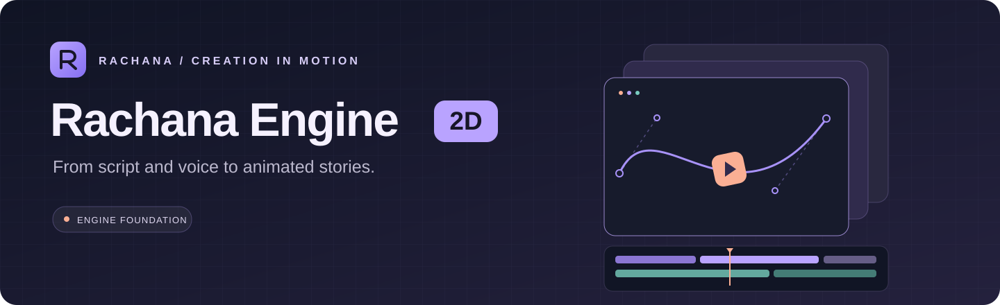
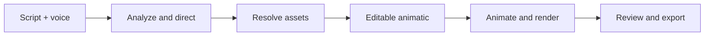

<p align="center">
  
</p>

<p align="center">
  <strong>From script and voice to animated stories.</strong><br>
  A reusable 2D animation engine and creator workflow, being built for narrated videos.
</p>

<p align="center">
  <a href="docs/ENGINE_PRODUCT_PLAN.md">Architecture</a> ·
  <a href="docs/ASSET_PIPELINE.md">Asset pipeline</a> ·
  <a href="ROADMAP.md">Roadmap</a> ·
  <a href="CONTRIBUTING.md">Contributing</a>
</p>

## Project status

**Initial foundation and architecture planning.** This repository contains the product plan, asset-generation design, release criteria, repository checks, and starter structure. The reusable renderer, generation adapters, and creator workflow are planned. It does not yet generate videos.

Created and maintained by [Tejas Dadhich (@Tejaa11)](https://github.com/Tejaa11).

## The idea

Give Rachana a script and recorded voice-over. The intended workflow analyzes the narration, plans shots, resolves or generates assets, builds an editable animatic, animates the scenes, and exports a video with captions and YouTube materials.

The goal is that a different creator can make a different video without editing engine source. Each film should have coherent art direction, meaningful character acting, readable diagrams, and sound that supports the narration.



*This diagram describes the planned workflow, not an available command.*

## Capability map

| Area | Status | Intended result |
| --- | --- | --- |
| Architecture, asset contracts, release criteria | Documented | Inspectable decisions and acceptance criteria |
| Repository integrity checks | Available | Check required files, local documentation links, SVG, and package metadata |
| Shared scene graph and animation runtime | Planned | Reusable actors, props, clips, cameras, and frame evaluation |
| Script and voice alignment | Planned | Editable narration anchors and mismatch reporting |
| Asset resolution and generation | Planned | Procedural creation, imports, and configurable provider adapters |
| Director workflow | Planned | Structured shot plans and synchronized animatics |
| Editing studio and CLI | Planned | Project intake, revisions, preview, and render controls |
| Delivery package | Planned | MP4, captions, thumbnails, titles, description, and chapters |

## Explore the foundation

Use Node.js 22 or newer and Git:

```sh
git clone https://github.com/Tejaa11/rachana-engine-2d.git
cd rachana-engine-2d
npm run check
```

The check has no package dependencies and needs no API key. CI runs it on Node.js 22 and 24. This is a documentation/scaffold check, not a render or media-quality test.

Start with:

- [Product plan and architecture](docs/ENGINE_PRODUCT_PLAN.md)
- [Asset generation and consistency](docs/ASSET_PIPELINE.md)
- [Release and quality standards](docs/RELEASE_STANDARD.md)
- [Build milestones](ROADMAP.md)
- [Project origins and current boundaries](docs/ORIGINS.md)

## How asset creation will work

Each shot declares its needs: an actor, environment, prop, diagram, sound cue, or product view. The resolver will reuse approved assets, create deterministic graphics, call a configured generation provider, or request an import.

Generated artwork and animated rigs have different capabilities. A flat character image does not automatically support walking or pointing. Rachana's asset contracts will make those distinctions explicit and preserve style references, provenance, and approved versions across shots.

Optional remote generation will require provider configuration and the user's credentials. Cost limits, bounded retries, and saved progress are design requirements. Universal asset generation and automatic perfect rigging are not current capabilities.

## Repository map

```text
docs/         Architecture, asset design, release criteria, and origins
packages/     Shared module boundaries for the upcoming implementation
examples/     Planned reproducible examples and their acceptance criteria
showcase/     Original banner; future reels must come from engine outputs
tools/        Dependency-free repository checks
.github/      CI and issue/PR templates
```

## First engineering milestone

Extract a portable, data-driven runtime and render a polished 45–60 second sample. Then render a second, unrelated script through the same runtime without adding custom scene functions. Later milestones add generation providers, the director workflow, the editing studio, and a verified full-length release.

See the [roadmap](ROADMAP.md) for exit criteria. Performance results and motion reels will be added when measured and rendered; no benchmark or completed-engine claim is made by this foundation.

## Contributing and credit

Read [CONTRIBUTING.md](CONTRIBUTING.md) before proposing changes. Design questions and bug reports have dedicated issue templates.

The work uses AI-assisted planning and development, with maintainer review. [LambdaEngine2D](https://github.com/devesh95official/LambdaEngine2D) inspired the repository's emphasis on modules, examples, and clear documentation. No LambdaEngine2D code is included in this scaffold. See [THIRD_PARTY.md](THIRD_PARTY.md) for attribution and media policy.

## License

[MIT](LICENSE), copyright 2026 Tejas Dadhich. External libraries, provider outputs, and contributed media retain their own applicable terms and notices.
