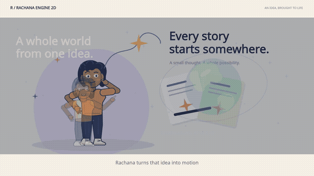
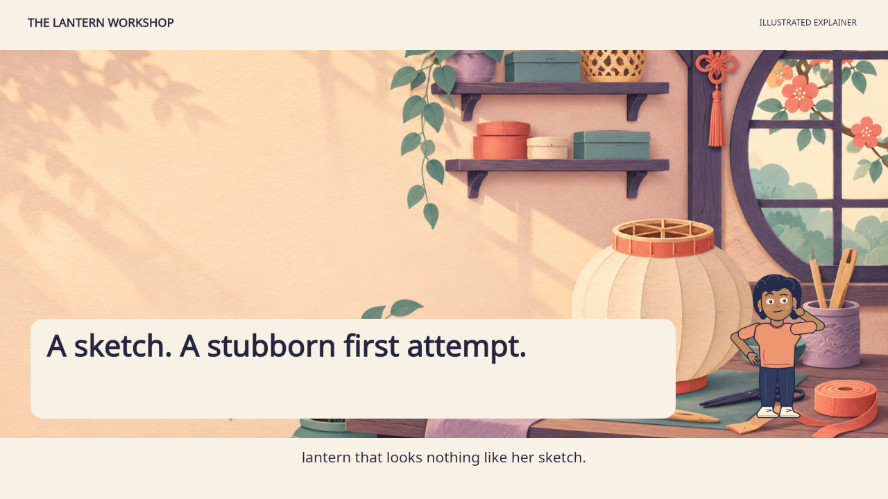
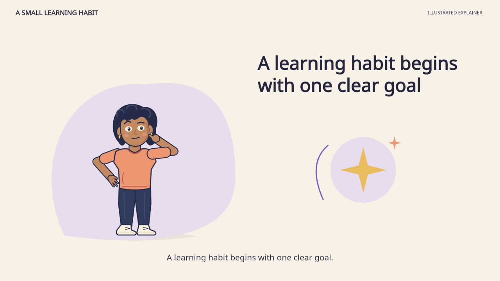
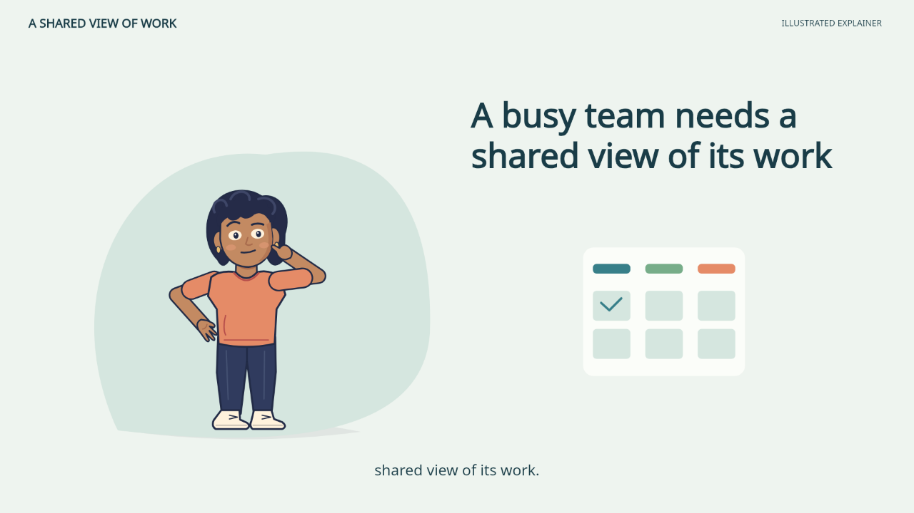
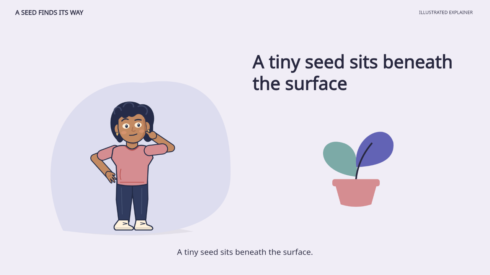
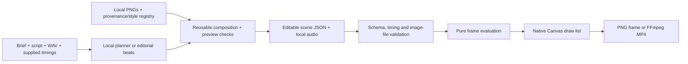

<p align="center">
  
</p>

<p align="center">
  <strong>From script and voice to animated stories.</strong><br>
  A declarative 2D scene runtime and narrated-video workflow in development.
</p>

<p align="center">
  <a href="QUICKSTART.md">Quickstart</a> ·
  <a href="docs/PRODUCTION_WORKFLOW.md">Create a pilot</a> ·
  <a href="docs/SCENE_FORMAT.md">Scene format</a> ·
  <a href="docs/ENGINE_PRODUCT_PLAN.md">Architecture plan</a> ·
  <a href="ROADMAP.md">Roadmap</a> ·
  <a href="CONTRIBUTING.md">Contributing</a>
</p>

## See the alpha in motion



The GIF is a silent excerpt from a real engine render. **[Watch the complete demo with narration](showcase/rachana-demo.mp4)**, inspect its [creative scene JSON](examples/narrated-story/creative.scene.json), or follow the [quickstart](QUICKSTART.md) to render it locally. The approximately 25-second creative cut follows Mira, an original recurring character, through five authored shots with expressive poses, curved vector art, narration-anchored reveals, and a quiet procedural music/effects mix. See the [creative direction](docs/CREATIVE_DIRECTION.md). The story and compositions are authored source, not choices made by an automatic director.

## Reusable artwork, now in the pipeline

[](showcase/lantern-workshop/film.mp4)

**[Watch The Lantern Workshop](showcase/lantern-workshop/film.mp4)** — a 48-second, nine-beat story using two original illustrated environments, a transparent prop, Mira acting and supplied narration timings. The [brief](examples/lantern-workshop/production.json) drives the shared composer; the [asset registry](examples/lantern-workshop/asset-registry.json) pins saved artwork and its provenance. These are authored editorial choices and development-generated images, not a live AI director/provider demonstration.

The new [image workflow](docs/IMAGE_ASSETS.md) lets other projects register local PNGs, check their hashes/dimensions/transparency, and reuse them in portable productions. No generation account is needed to render the included files.

## Shared defaults for new scripts

The new [production workflow](docs/PRODUCTION_WORKFLOW.md) takes a script, local WAV and matching supplied word timings, chooses reusable staging and writes an editable plan/scene with a preview report. [Three unrelated examples](showcase/generated/README.md) run through the same composer **without custom scene builders or editorial beats**:

| Learning | Teamwork | Nature |
| --- | --- | --- |
| [](showcase/generated/learning-habit.mp4) | [](showcase/generated/team-flow.mp4) | [](showcase/generated/seed-story.mp4) |

```sh
npm run cli -- produce examples/learning-habit/production.json --out renders/my-first-pilot
```

Run that after installation/build below. These 6–90 second illustrated pilots use local rules, not an AI director. Their shared defaults include six vector templates plus image-backed staging, three palettes, narration-timed reveals and measured text fitting. Optional editorial beats let you improve storytelling without changing the renderer. Reports expose density, pacing and generic-art concerns; every cut still needs creative review.

## Creative Director v1 — experimental

The [director workflow](docs/CREATIVE_DIRECTOR.md) adds optional Gemini and OpenAI provider adapters. They request an editable story analysis and shot plan, then the existing composer checks narration coverage, assets and layout. Missing artwork stays explicit; selected shots can be revised without accepting changes elsewhere. `director prepare/apply/inspect` also supports file handoff without a provider call.

```sh
npm run cli -- director prepare examples/director-signal/production.json --out renders/director-request
```

Live direction additionally requires your own local key and an explicit compatible model. Provider transports and failure cases are tested with mocks; **live model quality and the unfamiliar-script film acceptance test are still pending**. The new [A Quiet Signal input](examples/director-signal/README.md) has no manually authored beats and no claimed generated movie.

## Project status

**Working alpha 0.1.0-alpha.5: image assets, narrated-pilot composition and an experimental provider-driven director workflow.** Rachana validates scene files, evaluates nested animation directly at a requested time, draws PNG frames, and exports MP4 through FFmpeg. Live director creative acceptance, automatic recorded-voice alignment, image-generation providers, generic rig retargeting, cameras and an editing studio remain open work.

Created and maintained by [Tejas Dadhich (@Tejaa11)](https://github.com/Tejaa11), with AI-assisted development and maintainer review.

| Capability | Current status |
| --- | --- |
| Rectangles, circles, wrapped text, curved vector paths and nested groups | Implemented |
| Original Mira character: four poses, three expressions, bounded acting | Implemented prefab |
| Arc, drift, pop and reveal motion presets | Implemented editable clip builders |
| Position, opacity, scale and rotation clips; four easing curves | Implemented |
| Clip starts in seconds or relative to supplied word boundaries | Implemented |
| Schema and semantic checks for IDs, values, references and clip overlap | Implemented |
| Direct frame evaluation, PNG export and MP4 export | Implemented |
| Bundled fonts and an environment doctor | Implemented |
| Brief + script + WAV + supplied timing → editable pilot | Implemented constrained composer |
| Six vector templates, three image layouts, palettes, editorial beats and preview reports | Implemented |
| Local PNG registry, measured import, content-pinned image layers and portable asset snapshots | Implemented |
| Director draft contract, file handoff, Gemini/OpenAI adapters and scoped revisions | Implemented integration; live acceptance pending |
| Automatic transcription/alignment and TTS | Planned |
| Generative artwork, arbitrary character rigging and asset providers | Planned |
| Cameras, browser editor, persistent jobs, cache and resume | Planned |

## Render your first scene

Use **Node.js 22+**, npm, and a local **FFmpeg** executable with `libx264` and AAC support. Put FFmpeg on `PATH`, or set `FFMPEG_PATH` to its executable. See [setup and troubleshooting](QUICKSTART.md).

```sh
git clone https://github.com/Tejaa11/rachana-engine-2d.git
cd rachana-engine-2d
npm ci
npm run build
npm run cli -- doctor
npm run render:smoke
npm run render:creative
```

These create `renders/minimal.mp4` and `renders/rachana-creative.mp4`, each with a render manifest. The earlier shape-only example remains available through `npm run render:demo`. Outputs are never overwritten; choose a new output path when rendering a revision. No API key or paid provider is needed for these examples. npm needs network access to install the declared packages; rendering the included scenes then runs locally.

Change a shape's colors, position, timing, or text in its scene file, validate it, and render a new cut:

```sh
npm run cli -- validate examples/narrated-story/creative.scene.json
npm run cli -- frame examples/narrated-story/creative.scene.json --frame 30 --out renders/frame-30.png
npm run cli -- render examples/narrated-story/creative.scene.json --out renders/revision-1.mp4
```

## How it works



A scene describes the output, layers, animation clips, and optional narration-word anchors. A clip may begin at a fixed second or at the start/end of a word plus an offset. Frame evaluation depends on the scene and requested time, so it can seek directly without playing earlier frames. See the [scene contract](docs/SCENE_FORMAT.md) and [renderer decision](docs/adr/0001-renderer.md).

The narrated example includes original synthetic audio and synthesis-start timestamps. Word ends are approximate. This demonstrates supplied timing anchors; it does **not** demonstrate automatic alignment of a user's recording or phoneme lip sync. Audio origins, exact tool settings, and hashes are recorded in its [provenance](examples/narrated-story/provenance.json).

## Examples and verification

- [Minimal scene](examples/minimal-scene/scene.json): a two-second render fixture.
- [Creative narrated story](examples/narrated-story/creative.scene.json): five authored shots, an original reusable character, curved graphics and a precomposed procedural sound mix.
- [Earlier narrated shape study](examples/narrated-story/scene.json): a smaller example of supplied word anchors; render with `npm run render:demo`.
- [Lantern Workshop](examples/lantern-workshop/README.md): 48 seconds of authored story beats with reusable local artwork; selected [movie and evidence](showcase/lantern-workshop/README.md).
- [Shared-composer gallery](showcase/generated/README.md): three unrelated topics, generated through the same defaults, with input briefs and verification records.
- [Example notes](examples/README.md): media, timing, and scope.
- [Showcase](showcase/README.md): source-linked outputs and regeneration.

```sh
npm run check
npm test
npm run verify:smoke
```

`check` inspects repository files and documentation links. `test` builds the TypeScript and runs the automated suite. `verify:smoke` checks the generated minimal MP4; run `render:smoke` first. These checks have distinct scopes and do not establish the creative quality of every possible video. No performance benchmark or cross-platform pixel-identity claim is made by this alpha.

## Boundaries and next steps

Scene and production authoring currently use JSON. The runtime supports primitive/vector layers, nested groups, content-pinned static PNG image layers, a reusable original character prefab, and one optional local PCM16 WAV audio track. WAV duration must match the scene within one output frame; its timing data must already be supplied. The creative example precomposes narration, original procedural music and sound cues into that one WAV; it does not add a runtime multi-track mixer. The constrained composer turns short scripts with matching supplied timestamps into illustrated pilots. It does not yet turn an arbitrary script and unaligned recording into a complete film. Mira has a designed pose system, not automatic rigging/retargeting or phoneme lip sync.

The bundled Noto Sans, Devanagari, and Gujarati fonts avoid reliance on the maintainer's system fonts. They do not establish validated Indic speech alignment or universal glyph coverage. Broader language/shaping support is experimental and needs review fixtures.

Next work expands subject-specific art, character actions and composition, then validates the director against live model output and adds generation providers, recorded-narration analysis and an editing studio. See [ROADMAP.md](ROADMAP.md), the [product plan](docs/ENGINE_PRODUCT_PLAN.md), [asset design](docs/ASSET_PIPELINE.md), and [release standards](docs/RELEASE_STANDARD.md).

## Repository map

```text
packages/core/       Types, validation and pure animation evaluation
packages/renderer/   Canvas drawing, local media loading and FFmpeg export
packages/creative/   Original Mira character and reusable motion builders
packages/assets/     Local PNG inspection, registry import and provenance records
packages/director/   Constrained planning, reusable staging and preview reports
apps/cli/            doctor, validate, frame, render, compose and produce commands
schemas/             Versioned scene, production and image-registry JSON Schemas
examples/            Editable scene files and redistributable inputs
assets/fonts/        Bundled Noto fonts, OFL notice and source manifest
tests/               Runtime, validation and rendering-related checks
tools/               Repository verification and development utilities
showcase/            Real rendered outputs and original static branding
docs/                Scene contract, architecture decisions and product plans
```

## Contributing, credits and license

Read [CONTRIBUTING.md](CONTRIBUTING.md) before proposing a change. [LambdaEngine2D](https://github.com/devesh95official/LambdaEngine2D) inspired the emphasis on modules, examples, and accessible documentation. No LambdaEngine2D code, branding, or media is included. The earlier private productions informed the design; see [origins](docs/ORIGINS.md).

Original engine source is [MIT](LICENSE), copyright 2026 Tejas Dadhich. Canvas, Ajv, TypeScript, Noto fonts, optional development tools, and external media retain their own terms. See [THIRD_PARTY.md](THIRD_PARTY.md) and the included media/font provenance records.
