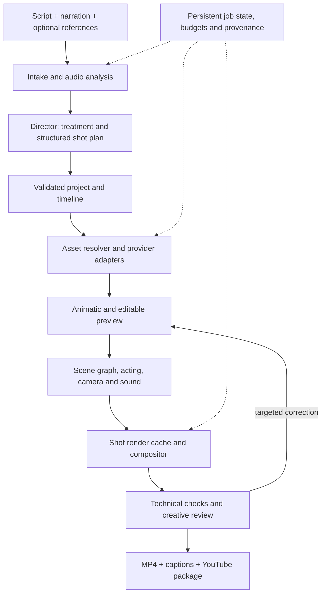

# Rachana Engine 2D — product and engineering plan

Planning revision: 13 November 2026. Product: **Rachana Engine 2D**. Creator and maintainer: **Tejas Dadhich (@Tejaa11)**. Repository: `Tejaa11/rachana-engine-2d`.

Tagline: **From script and voice to animated stories.** The GitHub repository name is selected; package-registry and brand availability have not been checked.

**Status:** design and release requirements, not implemented feature claims. The existing Voxam and CareClinic films are working production prototypes. A portable, general-purpose agent and asset-generation engine still need to be built.

## 1. Product promise

A creator provides a script and recorded narration, optionally adds references and a style preference, and receives a reviewable animated video plus a YouTube upload package. A different creator can install the same engine and make a different video without changing rendering source code.

The first release focuses on polished 2D explainers, educational stories and product walkthroughs, in English and 16:9 1080p. Content topics should be configurable. More languages, formats, visual treatments and media providers can extend this foundation. Full 3D productions, arbitrary photorealistic film and universally correct automatic character rigging are separate capabilities, not implied by accepting arbitrary scripts.

The quality goal is a video a creator is willing to publish after review. An automated score alone cannot establish artistic quality or audience retention. The engine must provide good defaults, targeted revision tools and evidence of technical correctness.

### What “generate the required assets” means

Every shot declares what it needs. The engine resolves those needs through existing approved assets, procedural creation, configured generation providers or explicit import. It can create original backgrounds, props, compatible character designs, diagrams, typography, transitions, sound cues and thumbnails within its declared capabilities. Missing capabilities produce an actionable asset request or an explicitly identified alternative.

A generated painting of a character, a puppet with movable body layers and a fully rigged actor are different deliverables. The system must know which it received before assigning actions. See [the asset pipeline](ASSET_PIPELINE.md).

## 2. Origins and immediate engineering work

Earlier private Voxam and CareClinic productions explored procedural actors, shot direction, narration-led previews, captions, and Canvas-to-FFmpeg export. Their project-specific source and supplied media are not bundled in this repository. See [origins](ORIGINS.md).

The public foundation currently contains design documents, repository checks, and scaffolding. Extraction of a shared runtime has not started here. Immediate work includes portable dependencies, a stage-aware project schema, generic scene evaluation, real asset/provider interfaces, and measured quality checks. Legacy prototype assumptions must be removed rather than presented as reusable engine guarantees.

Preserve original inputs and approved film outputs outside the public engine package. Public examples must use redistributable media and work without the maintainer's private environment.

## 3. User experience

1. Create a project; paste/import the script and select the narration file.
2. Choose or accept an inferred visual treatment. Optionally provide brand, audience, screenshots, character references and material the video must use.
3. See script/audio differences, estimated generation needs, cost ceiling and provider requirements before remote generation.
4. Review a synchronized animatic with scene cards, narration waveform and editable shot direction.
5. Produce a detailed cut; revise a shot, asset, camera move or sound cue without rebuilding everything.
6. Review the film, then export MP4, captions, thumbnail variants, title options, description and chapters.

Offer an automatic mode for routine stages and a director mode with additional creative checkpoints. Generating a local file can proceed under the selected project settings; uploading or publishing it is a separate action. User requests such as “make this scene calmer” become scoped edits with a visible change summary and undo.

## 4. System architecture



Use one workflow coordinator with explicit stage contracts. Specialized director, asset and reviewer roles can be tasks within that workflow; many independently chatting agents are not a prerequisite. Parallelize independent assets or shots within a resource limit.

### Modules and responsibilities

| Module | Responsibility |
| --- | --- |
| Project/schema | Versioned project, timeline, shot, actor, asset, caption and audio-track definitions; migrations and validation |
| Runtime | Scene hierarchy, transforms, time, easing, layers, masks, seeded effects and camera evaluation |
| Motion | Rig data, reusable clips, transitions, pose blending, look targets, gesture timing and object constraints |
| Director | Script interpretation, narration anchors, visual beats, composition, continuity and variation |
| Assets/providers | Capability matching, asset requests, generation/import, quality checks, provenance and caching |
| Audio | Decode, transcription/alignment adapter, voice activity, word anchors, mixing, ducking and measured export levels |
| Workflow | Persistent jobs, progress, cancellation, resume, bounded retries, cost/resource ceilings and event history |
| Render/export | Browser/native adapters, shot frame generation, FFmpeg assembly, captions and deliverable manifests |
| Studio/CLI | Two clients for the same underlying project and workflow services |
| Quality | Schema checks, frame/layout analysis, export decode, regression fixtures and review reports |

### Proposed implementation direction

Use TypeScript for new shared project/runtime/workflow code, retaining the existing JavaScript through adapters during migration. Keep Canvas rendering and FFmpeg initially; prove an alternative renderer only if a measured limitation warrants it. Put speech processing behind an optional worker with pinned dependencies. Persist local jobs in a small database and store media by content hash. Start with local execution; hosted accounts, billing and distributed rendering can follow demonstrated demand.

Select specific model and media providers after small capability/quality/cost trials. Implement a provider-neutral interface, one real planner adapter and one real image adapter before claiming generative production. CI can use recorded fixtures and mocks, but those do not count as a working live integration. Each user's credentials come from local configuration and are excluded from project exports and logs.

### Data and execution rules

- Use integer frame boundaries and an explicit frame rate; retain audio positions in sample/time units with a documented conversion. Shot intervals are half-open, so seeking to a cut selects exactly one shot.
- Align the script to the actual recording, report mismatches and uncertainty, and preserve originals. Word timestamps and lip-sync capability must be labelled accurately.
- Every shot records its narration interval, purpose, composition, asset IDs, acting beats, camera path and caption-safe regions.
- Evaluate a frame directly from time and frozen project state. Seeking should not depend on having played earlier frames.
- Generative results are saved artifacts. Pin prompts, models/settings where available, reference hashes and approved outputs. A reproducible render means replaying saved artifacts in a documented environment; regeneration through a model is not promised to be identical.
- Accept generated plans as constrained data. Never execute arbitrary generated scripts or code from project inputs to draw a scene.
- Schema-invalid plans get a bounded repair attempt and a clear report. Artistic disagreements remain editable choices rather than infinite automated regeneration.
- Cache keys include content, dependencies, renderer/font versions and output settings. Changing a shared actor invalidates all affected shots; changing a title changes only dependent outputs.

### Workflow reliability

Each stage records `pending`, `running`, `succeeded`, `failed`, `cancelled` or `needs_input`, along with its inputs, output artifact hashes, attempts and timing. Save outputs atomically. Resume completed work after interruption. Provider timeouts, rate limits and invalid results have distinct recovery paths. A cancelled request that has already reached a provider can still incur cost; reconcile the provider job before retrying. Unknown pricing must be shown as unknown, not zero. Exhausted retries or budget pauses the dependent work instead of silently lowering quality.

## 5. What makes the motion worth watching

Create a consistent art direction for each film: palette, outlines, typography, character proportions, environment design, texture and lighting. Reference sheets and approved asset IDs persist across shots.

Characters should have readable intent: anticipation before gestures, eye and head direction, grounded contact with props, different listening/thinking/explaining poses, expressive reactions and movement that settles. Camera moves and transitions should clarify the story. Use wide, medium, close, over-the-shoulder and diagram compositions where useful; a screen that needs reading gets a stable hold. Avoid cycling the same pose every fixed number of seconds.

The initial motion library should cover idle, listen, think, explain, point, walk, sit, stand, nod, react, type and hold/interact with a prop. A procedural rig and a raster cutout can participate in the same film, but their supported actions differ. Phoneme mouth shapes are a later capability requiring suitable alignment, not a claim derived from amplitude animation.

Use a short opening hook, callbacks, visual metaphors and a deliberate ending when the supplied script supports them. Preserve the user's words by default; propose rewrites separately rather than putting different text under an unchanged narration.

## 6. Milestones and exit evidence

Versions below are proposed engine milestones, separate from the legacy film package's `3.0.0` label. Progress is based on exit evidence, not dates or number of generated files.

| Milestone | Deliverable | Required exit evidence |
| --- | --- | --- |
| M0 — foundation | Clean engine layout, schema, portable dependencies, environment doctor, measured current-state report | New project validates before a final video exists; no private absolute paths; sample media is publishable |
| M1 — reusable runtime | Shared scenes, rigs, text layout, cameras, sound tracks and CLI render | 45–60 second film driven by project data; second unrelated script uses the same runtime without new scene code; seek/render checks |
| M2 — asset pipeline | Registry, procedural assets, import, real image provider, consistency sheets and bounded jobs | Resolve new background and prop requests live; render only supported actor actions; one provider failure can be retried/resumed without duplicating completed assets |
| M3 — creative workflow | Script/audio intake, real director adapter, narration mapping, animatic and resumable stages | Three unseen topic scripts produce usable first animatics with no renderer edits; mismatch and unsupported-asset paths demonstrated |
| M4 — creator studio | Intake, storyboard, timeline, asset replacement, waveform, undo and export UI | Another person can create and revise a film using the documented workflow without source edits |
| M5 — production release | Full-length film, measured QA, tested installers, showcase and release package | All release standards pass; actual demo media and reproducible evidence accompany the tagged release |

The first build slice is M0→M1. A polished minute proves the engine contracts and motion quality before scaling generation to a long film. After that, add asset and director automation, then the studio around working services.

## 7. Generalization and evaluation

Maintain examples for a product walkthrough, a science/education explainer and a fictional story. Use a fourth unfamiliar script for a generalization check. Include a 6–8 minute production to exercise consistency, drift, caching and memory. Each public sample has redistributable media and provenance; the existing personal voice files are not automatically part of the release.

Test long words, repeated paragraphs, sparse narration, long pauses, unusually dense diagrams, script/audio mismatches, provider timeouts and interrupted renders. Unsupported languages, output modes or asset kinds should fail early with useful guidance. Describe supported platforms and providers only after testing them.

See [release standards](RELEASE_STANDARD.md) for technical, creative, installability and portfolio acceptance criteria.

## 8. Repository and résumé presentation

The reference [LambdaEngine2D repository](https://github.com/devesh95official/LambdaEngine2D) presents modules, examples, templates, build instructions, documentation and license information. Borrow that evidence-oriented structure. Build an independent engine identity and make its technical contributions easy to inspect; an attractive README alone is insufficient.

Proposed layout:

```text
packages/     schema, runtime, motion, assets, workflow, render, providers
apps/         CLI and local studio
examples/     minimal scene, motion lab, educational, product, story
templates/    starter project formats and style presets
docs/         quickstart, architecture, API, recipes, providers, troubleshooting
showcase/     small approved GIFs/posters; links to full videos
tests/        timing, schema, render, asset and workflow fixtures
benchmarks/   scripts, environments, measurements and methodology
.github/      CI, issue templates and contribution workflow
```

The final README leads with an original banner, a short motion reel and a real sample. Follow with a clear capability/status table, verified quickstart, architecture, examples, provider requirements/costs, documented limitations, benchmarks, contribution links and credits. Use real build badges only after their workflows run. Keep full videos and model weights out of the ordinary source download; provide versioned download links and checksums where appropriate.

Authorship should clearly identify the user as project creator/maintainer with the chosen public name and handle. Record third-party libraries, providers, media and any borrowed code accurately. Describe AI assistance honestly. Do not imply that using the reference engine for inspiration makes its code ours, and do not remove another contributor's credit. Confirm distribution choices before committing a public license or redistributing supplied media.

Provide an interview guide explaining time evaluation, narration alignment, render parity, provider boundaries, resume/cache behavior and quality tradeoffs. Add résumé bullets only for implemented capabilities, with measured numbers linked to benchmarks. Never invent adoption, speedups, retention, platform support or asset-generation success rates.

GitHub's own [README guidance](https://docs.github.com/en/repositories/managing-your-repositorys-settings-and-features/customizing-your-repository/about-readmes) supports a concise introduction and quickstart with longer documentation elsewhere. Its [résumé guidance](https://docs.github.com/en/account-and-profile/tutorials/using-your-github-profile-to-enhance-your-resume) also emphasizes demos, setup, readable code and tests.

## 9. Decisions deliberately left until their milestone

- Evolve the visual identity as the runtime and real showcase examples are developed; the product name, public maintainer and GitHub slug are selected.
- Specific providers: compare real sample quality, consistency, output capabilities, resource needs and current terms at M2/M3; record the choice and alternatives.
- Code is MIT licensed in this repository. Review redistribution rights separately for each external media fixture and dependency as they are added.
- Cloud hosting and monetization: defer until local workflow and output quality are proven.
- Broader styles, languages and 3D: add explicit adapters, samples and tests; do not advertise blanket support.

This initial repository contains architecture plans and a project scaffold. No generation provider is configured and no reusable video-generation command is available yet. Private production media and credentials are excluded.
