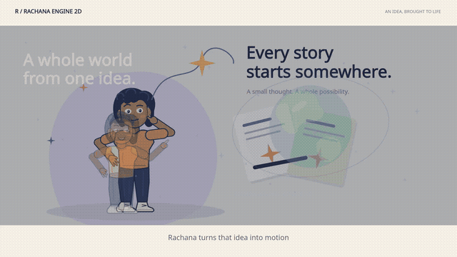

# Showcase

## Real engine output

- [Full narrated demo MP4](rachana-demo.mp4)
- [Preview still](preview.png)
- [Editable source scene](../examples/narrated-story/creative.scene.json)
- [Script and media provenance](../examples/narrated-story/provenance.json)

The GIF is a silent excerpt. Watch the MP4 for narration and timing. The creative cut includes five authored compositions, the same original Mira character in multiple poses, curved vector art, ordinary transform clips, narration and a quiet precomposed procedural music/effects bed. All visuals are rendered by the shared runtime from editable scene data. No autonomous director, generative image provider, automated speech alignment, generic rig retargeting or phoneme lip sync is demonstrated. See the [creative direction](../docs/CREATIVE_DIRECTION.md).

To render the underlying film, install/build using [QUICKSTART.md](../QUICKSTART.md), then run `npm run render:creative`. The local output is `renders/rachana-creative.mp4`; the selected public movie retains the showcase filename `rachana-demo.mp4`. `npm run showcase` is the developer command for producing showcase assets; inspect its current output paths before replacing selected public artifacts. Local movie renders are normally kept outside the source tree.

## Branding and scope

The original [static banner](banner.svg) represents layers, motion paths and a timeline. It is branding rather than a screenshot of an editing studio.

These examples demonstrate the current alpha, not a final YouTube production standard. No render-speed benchmark, native/browser pixel parity or unsupported-platform guarantee is inferred from the showcase. Future reels should link to their exact source examples, describe external providers/manual preparation, and include publishable media provenance.

The earlier shape-only study remains at [scene.json](../examples/narrated-story/scene.json), rendered by `npm run render:demo`. The creative showcase changes visual direction without removing that smaller runtime fixture.
