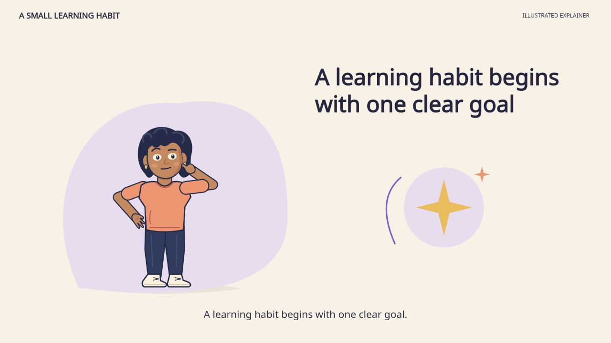
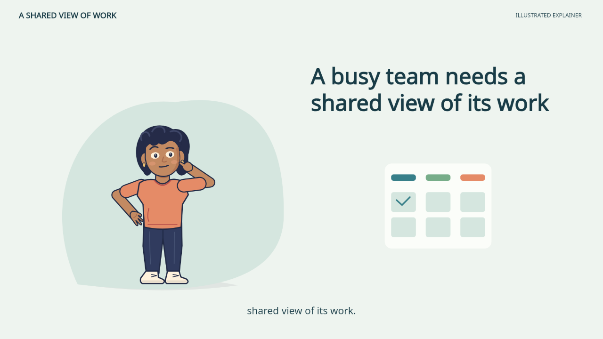
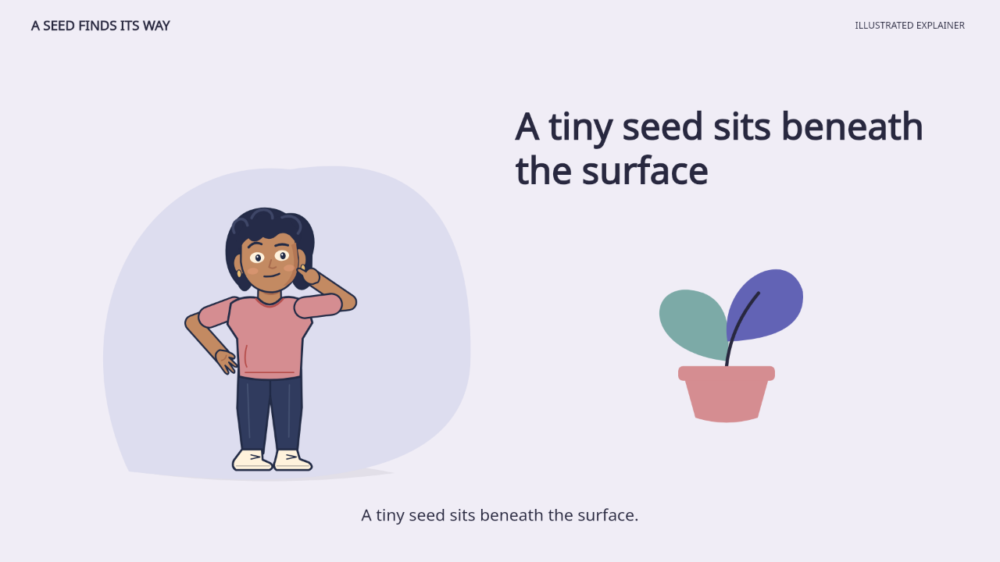

# Shared-composer gallery

Three original topics, the same `produce` command. These briefs supply script, audio, matching timings, title and palette. **None supplies custom scene code or editorial beats.** This gallery shows the current shared defaults; the [authored hero](../rachana-demo.mp4) remains a separate creative reference.

| Topic | Rendered movie | Inputs | Evidence |
| --- | --- | --- | --- |
| Learning habit | [Watch MP4](learning-habit.mp4) · [storyboard](learning-habit-storyboard.png) | [brief](../../examples/learning-habit/production.json) · [provenance](../../examples/learning-habit/provenance.json) | [preview report](learning-habit.quality-report.json) · [decode verification](learning-habit.mp4.verification.json) |
| Team flow | [Watch MP4](team-flow.mp4) · [storyboard](team-flow-storyboard.png) | [brief](../../examples/team-flow/production.json) · [provenance](../../examples/team-flow/provenance.json) | [preview report](team-flow.quality-report.json) · [decode verification](team-flow.mp4.verification.json) |
| Seed story | [Watch MP4](seed-story.mp4) · [storyboard](seed-story-storyboard.png) | [brief](../../examples/seed-story/production.json) · [provenance](../../examples/seed-story/provenance.json) | [preview report](seed-story.quality-report.json) · [decode verification](seed-story.mp4.verification.json) |





All three are 1920×1080, 30 fps H.264/AAC movies with synthetic formant narration and original engine-native art. There is no generated bitmap artwork or music bed. Subject graphics are decorative motifs, not factual diagrams or product evidence. Supplied word starts come from synthesis events; ends are approximate.

The [index](index.json) records selected artifact hashes, durations and staging. Reports expose remaining review points. Layout checks and successful full decode do not certify story quality, subject accuracy or a universal level of artistic performance. The unfamiliar-script regression test uses an additional observation-themed script; that test exercises composition and is not a fourth narrated showcase.

## Reproduce

Follow [QUICKSTART.md](../../QUICKSTART.md), then:

```sh
npm run cli -- produce examples/learning-habit/production.json --out renders/public-gallery/learning-habit
node tools/verify-smoke.mjs renders/public-gallery/learning-habit/film.mp4
npm run cli -- produce examples/team-flow/production.json --out renders/public-gallery/team-flow
node tools/verify-smoke.mjs renders/public-gallery/team-flow/film.mp4
npm run cli -- produce examples/seed-story/production.json --out renders/public-gallery/seed-story
node tools/verify-smoke.mjs renders/public-gallery/seed-story/film.mp4
```

Use new directories for another revision. `node tools/build-production-gallery.mjs` refreshes these **selected public artifacts**, intentionally replacing their prior copies only after checking source IDs and movie hashes against successful verification records. Optional arguments choose the render root and directory suffix. Movies are rendered by the shared engine, not produced by the gallery packager. Encodes/font rasterization can differ by platform; committed verification describes these exact files.

For your own script or stronger editorial control, see the [production workflow](../../docs/PRODUCTION_WORKFLOW.md).
