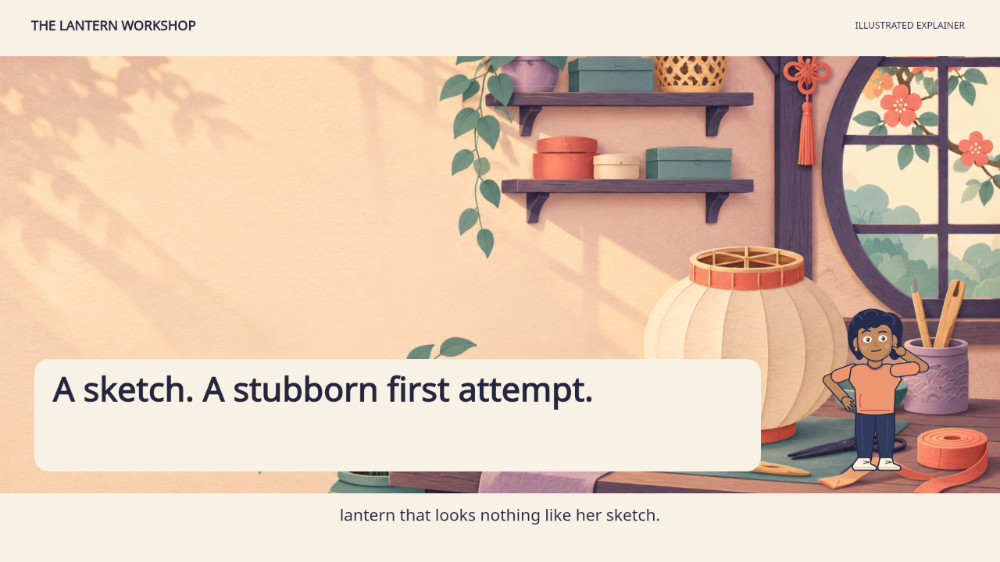

# The Lantern Workshop — image-backed production

[](film.mp4)

[Watch the 48-second MP4](film.mp4) · [Nine-shot storyboard](storyboard.png) · [Input brief](../../examples/lantern-workshop/production.json) · [Image workflow](../../docs/IMAGE_ASSETS.md)

This is a real 1920×1080, 30 fps engine render: 1,441 video frames, H.264 with AAC narration. Nine authored beats combine two original generated development environments, one reusable transparent cutout, Mira's vector acting, crisp text and supplied narration timings. The same registry/composer/renderer supports other projects; no story-specific renderer function is used.

Evidence: [render manifest](film.mp4.manifest.json), [full-decode verification](film.mp4.verification.json), [preview report](quality-report.json), [compiled plan](plan.json), and [selected artifact index](index.json). Measurements describe this file rather than a cross-platform byte-identity or aesthetic-quality guarantee.

The [example notes](../../examples/lantern-workshop/README.md) link the original script, synthesis provenance, asset request/registry and [exact artwork prompts](../../examples/lantern-workshop/art-prompts.json). Imagegen was used during development. Rendering loads saved PNGs; the engine does not invoke a live generation provider. Environment lanterns are decorative details, while the standalone cutout preserves its exact silhouette when reused. Physical folding, contact/grip motion, rigging and phoneme lip sync are not implemented.

## Regenerate

After the [quickstart](../../QUICKSTART.md):

```sh
npm run cli -- produce examples/lantern-workshop/production.json --out renders/lantern-workshop-release
node tools/verify-smoke.mjs renders/lantern-workshop-release/film.mp4
node tools/build-asset-showcase.mjs
```

Choose a new production directory for a revision. Pass that directory as the optional argument to the showcase tool. The packager checks the verified movie's hash and frame count, renders PNG previews from the composed scene, then intentionally refreshes only these selected public showcase copies. It does not generate artwork or render the movie itself.
